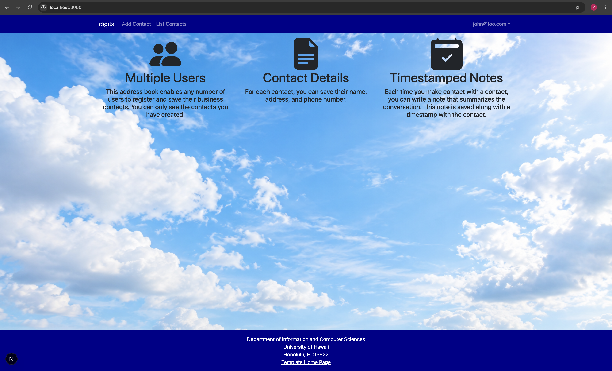

# Digits - Contact Manager

Digits is a contact management application built with Next.js, TypeScript, and PostgreSQL. Users can create accounts, save their contacts, and add timestamped notes to keep track of conversations.

## Installation

1. Clone the Digits repository from GitHub.
2. Open the project folder in VS Code.
3. Install the dependencies:

   ```bash
   npm install
   ```

4. Make sure PostgreSQL is installed and running.
5. Create a PostgreSQL database named `digits`:

   ```bash
   createdb digits
   ```

6. Create a `.env` file using `sample.env` as a guide. Configure the database connection and authentication settings.

7. Set up the database tables:

   ```bash
   npx prisma migrate deploy
   ```

8. Seed the database with default users and contacts:

   ```bash
   npx tsx prisma/seed.ts
   ```

9. Start the application:

   ```bash
   npm run dev
   ```

10. Open http://localhost:3000 in your browser.

## Application Walkthrough

### Landing Page

The landing page introduces the three main features of Digits: multiple users, contact details, and timestamped notes.

### Sign Up Page

New users can create an account to start managing their contacts.

### Sign In Page

Existing users can sign in to access their saved contacts.

For testing, use:
- Email: `john@foo.com`
- Password: `changeme`

### Add Contact Page

Users can add a contact by entering their name, address, image, and description.

### List Contacts Page

This page displays the contacts saved by the signed-in user. Users can view their contact information and add notes.

### Edit Contact Page

Users can edit their existing contacts to update their information.

### Timestamped Notes

Users can write notes about their conversations with contacts. Each note is saved with a timestamp.

### Admin Page

Administrators can view and manage contacts through the Admin page.

## Technologies Used

- Next.js
- React
- TypeScript
- Bootstrap
- PostgreSQL
- Prisma
- NextAuth

## Author

Mina Girgis
ICS 314 - Fall 2026
